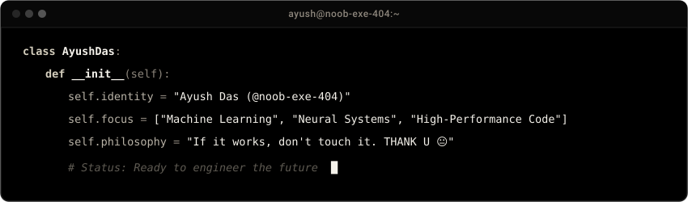

  <!-- Animated Header Wave Banner -->
  

  <!-- Dynamic Typing SVG Animation -->
  

  <!-- Animated Glowing Divider -->
  

   

  <!-- Interactive Terminal Card -->
  

    

  <!-- Telemetry & Quick Indicators -->
  

    
    
    
  

  <!-- Transmission Channels / Socials -->
  

    
    
    
    
  

  <!-- Animated Glowing Divider -->
  

 

## 🛠️ Tactical Stack & Arsenal

### ⚡ Core & Systems Programming

  
  
  
  
  
  
  
  
  

### 🧠 AI, Deep Learning & Scientific Computing

  
  
  
  
  
  
  
  
  
  
  
  

### ☁️ Cloud, Databases & Infrastructure

  
  
  
  
  
  
  
  
  
  
  

### 🎮 Game Engines, Creative Suite & Hardware

  
  
  
  
  
  
  
  
  

<!-- Animated Glowing Divider -->

 

## 📊 Telemetry & Performance Metrics

  <table border="0" cellspacing="0" cellpadding="0">
    <tr align="center">
      <td>
        
      </td>
      <td>
        
      </td>
    </tr>
  </table>

   

  <!-- Top Languages Compact Card -->
  

    

  <!-- Interactive Activity Graph -->
  

<!-- Animated Glowing Divider -->

 

## 🐍 Contribution Ecosystem

  

 

<!-- Animated Footer Wave -->

  

  

    Crafted with precision • Monochromatic Dark Aesthetic • <a href="https://github.com/noob-exe-404">@noob-exe-404</a>
  

