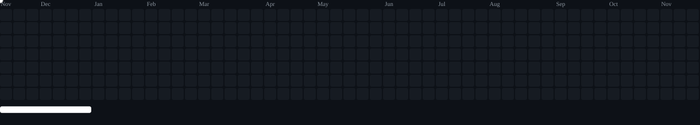

  <!-- Dynamic Typing Animation (Cream Font, Transparent Background) -->
  

  

    <em>"If it works, don't touch it. THANK U 😒"</em>
  

   

  <!-- Compact Skill Arsenal -->
  

    
  

   

  <!-- Seamless Streak Telemetry (Matches GitHub Dark #0D1117, Cream Accents) -->
  

    
  

   

  <!-- Smooth Commit Activity Graph (Seamless #0D1117 Background & Cream Curve) -->
  

    
  

   

  <!-- Breakout Contribution Game Animation -->
  

    <picture>
      <source media="(prefers-color-scheme: dark)" srcset="./assets/breakout-contribution-graph-dark.svg">
      <source media="(prefers-color-scheme: light)" srcset="./assets/breakout-contribution-graph.svg">
      
    </picture>
  

   

  <!-- Minimalist Social Badges -->
  

    
    
    
  

   

  

    <i>If anything breaks, I wasn't here.</i>
  

